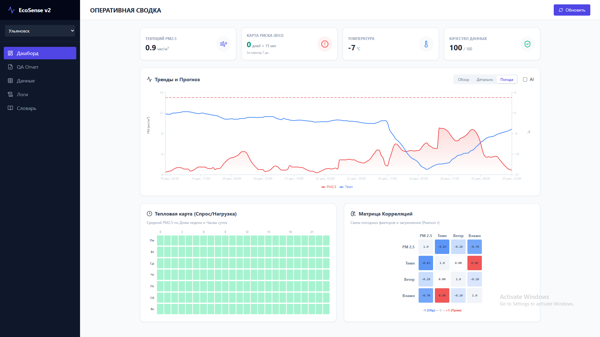
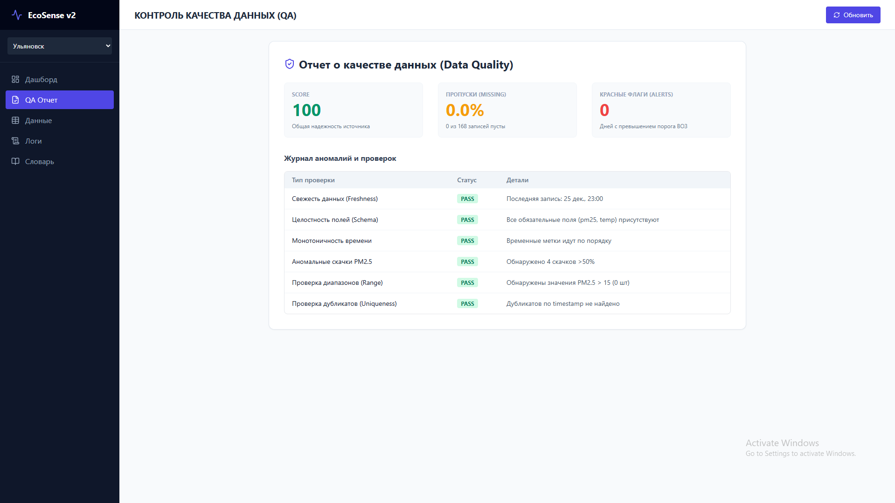
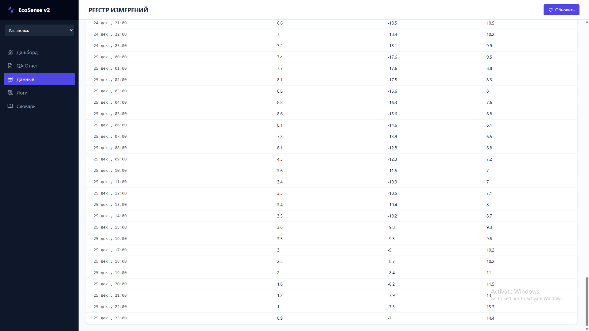

# 🌿 EcoSense Analytics v2

**Система мониторинга качества воздуха и экологической аналитики**

---

## 📋 Оглавление

- [О проекте](#-о-проекте)
- [Наша Команда](#-наша-команда)
- [Архитектура пайплайна](#-архитектура-пайплайна)
- [Функциональность](#-функциональность)
- [Скриншоты](#-скриншоты)
- [Технологический стек](#-технологический-стек)
- [Структура проекта](#-структура-проекта)
- [Быстрый старт](#-быстрый-старт)
- [Полная документация](#-полная-документация)
- [Развертывание](#-развертывание)

---

## 🌍 О проекте

EcoSense — это full-stack приложение для мониторинга качества воздуха в 13 городах мира. Система:
- **Автоматически собирает** данные о погоде и загрязнении воздуха (PM2.5, PM10) через Open-Meteo API
- **Обрабатывает** данные с помощью ETL пайплайна (Extract → Transform → Validate → Load)
- **Предсказывает** PM2.5 с помощью Linear Regression ML модели
- **Хранит** в PostgreSQL базе с Star-схемой
- **Предоставляет** REST API для доступа к данным
- **Визуализирует** на интерактивном React дашборде с графиками и аналитикой

---

## 👥 Наша Команда

| Роль | ФИО Студента | Ключевые Ответственности |
| :--- | :--- | :--- |
| **Менеджеры проекта** | Сидорова Александра | Планирование спринтов, управление рисками, общая отчётность. |
| **Разработчики** | Титков Андрей,Бурнаев Андрей  | Написание кода transform и load, настройка БД. Дизайн Airflow DAG, реализация клиентов API. |
| **Тестировщики / QA & Аналитики** | Бурнаев Андрей | Проектирование витрины и дашборда, разработка DQ-правил, финальная аналитика. Реализация визуализаций в BI-инструменте. |

---

## 🔄 Архитектура пайплайна

```
SOURCES (Open-Meteo API)
    ↓
EXTRACT (fetch_open_meteo_data) → JSON weather + air quality
    ↓
TRANSFORM (transform_data + ML) → DataFrame + PM2.5 predictions
    ↓
VALIDATE (quality checks) → Data quality report
    ↓
LOAD (to PostgreSQL) → Star schema (dim_city, fact_weather, fact_air_quality)
    ↓
STORAGE (SQL VIEW) → dm_dashboard_analytics
    ↓
API (FastAPI) → GET /api/cities, /api/measurements
    ↓
UI (React + Recharts) → Interactive Dashboard
```

**Важно**: Для детального понимания архитектуры смотрите **`docs/PIPELINE.md`** и **`docs/DATAFLOW.md`**

---

## ✨ Функциональность

| Модуль | Описание |
|--------|----------|
| **Дашборд** | Визуализация KPI (PM2.5, температура, качество данных), графики трендов с AI-прогнозом, тепловая карта, матрица корреляций |
| **QA Отчет** | Контроль качества данных: оценка пропусков, проверка диапазонов (ВОЗ), свежесть данных |
| **Реестр данных** | Таблица с историей измерений |
| **Логи** | Системные логи загрузки и ошибок |
| **ETL Pipeline** | Автоматический сбор данных из Open-Meteo API и обучение ML-модели (Linear Regression) |

---

## 📸 Скриншоты

### Главный дашборд


### QA Отчет


### Реестр данных


---

## 🛠 Технологический стек

### Frontend
| Технология | Версия | Назначение |
|------------|--------|------------|
| React | 19.2.0 | UI Framework |
| TypeScript | 5.8.x | Типизация |
| Vite | 6.2.0 | Сборщик |
| Recharts | 3.5.1 | Графики и диаграммы |
| Lucide React | 0.555.0 | Иконки |

### Backend
| Технология | Версия | Назначение |
|------------|--------|------------|
| Python | 3.9+ | Язык программирования |
| FastAPI | 0.109.0 | REST API Framework |
| Uvicorn | 0.27.0 | ASGI сервер |
| Psycopg2 | 2.9.9 | PostgreSQL драйвер |
| Pandas | 2.2.0 | Обработка данных |
| Scikit-learn | 1.4.0 | Машинное обучение |

### Database
| Технология | Назначение |
|------------|------------|
| PostgreSQL | Реляционная СУБД |

---

## 📂 Структура проекта

```
ecosense-аналитика/
├── index.html              # Точка входа HTML
├── index.tsx               # Точка входа React
├── App.tsx                 # Главный компонент приложения
├── types.ts                # TypeScript типы
├── vite.config.ts          # Конфигурация Vite
├── tsconfig.json           # Конфигурация TypeScript
├── package.json            # Зависимости Node.js
├── requirements.txt        # Зависимости Python
│
├── server.py               # FastAPI сервер (REST API)
│
├── components/
│   ├── DashboardCharts.tsx # Графики: TrendsChart, CorrelationMatrix, TrueHeatmap
│   └── ETLLogs.tsx         # Компонент логов ETL
│
├── services/
│   ├── api.ts              # API клиент для фронтенда
│   └── etl.py              # ETL пайплайн (сбор данных + ML)
│
├── project_v5_implementation/
│   ├── schema.json         # Описание схемы БД
│   └── backend/            # Дополнительные backend файлы
│
├── ecosenseDB.sql          # Полный дамп базы данных
└── ecosense.sql            # Схема таблиц
```

---

## 🚀 Установка и запуск

### Предварительные требования

- **Node.js** 18+ — [Скачать](https://nodejs.org/)
- **Python** 3.9+ — [Скачать](https://www.python.org/)
- **PostgreSQL** 14+ — [Скачать](https://www.postgresql.org/)

---

### 1. Настройка базы данных

1. Убедитесь, что PostgreSQL запущен.

2. Создайте базу данных:
   ```sql
   CREATE DATABASE ecosense;
   ```

3. Импортируйте схему:
   ```bash
   psql -U postgres -d ecosense -f ecosenseDB.sql
   ```

---

### 2. Backend

```bash
python -m venv venv
venv\Scripts\activate     # Windows
# source venv/bin/activate  # Linux/macOS

pip install -r requirements.txt
python services/etl.py    # Заполнить БД
python server.py          # Запустить API (http://localhost:8000)
```

---

### 3. Frontend

```bash
npm install
npm run dev  # http://localhost:5173
```

---

## � Полная документация

После быстрого старта ознакомьтесь с документацией:

| Документ | Назначение | Время |
|----------|-----------|-------|
| **`docs/INDEX.md`** | Навигация по всей документации | 5 мин |
| **`docs/PIPELINE.md`** | Полная архитектура ETL (Extract → Transform → Load) | 30 мин |
| **`docs/DATAFLOW.md`** | Диаграммы потока данных, примеры трансформации | 20 мин |
| **`docs/QUICKSTART.md`** | Команды для запуска и отладки | 15 мин |
| **`docs/CODE_REVIEW.md`** | Анализ кода, проблемы и рекомендации | 10 мин |

---

## 🔴 Критично: ETL Scheduling

По умолчанию ETL запускается **вручную**:
```bash
python services/etl.py
```

Для production требуется **автоматический запуск каждые 6 часов**. Выбор:

1. **Linux/macOS**: Cron job
2. **Windows**: Task Scheduler
3. **Production**: Docker + APScheduler

Читать: **`docs/CODE_REVIEW.md`** → "ETL: Нет scheduling"

---

## 📡 API

Доступна автоматическая документация: **http://localhost:8000/docs**

### Endpoints

| Метод | Путь | Описание |
|-------|------|----------|
| GET | `/` | Статус |
| GET | `/api/cities` | Список городов |
| GET | `/api/measurements?city_name={name}` | Данные по городу (168 часов) |

---

## 🎯 ETL Pipeline Этапы

```
EXTRACT (Open-Meteo API) → JSON data (weather + air quality)
    ↓
TRANSFORM (pandas + ML) → DataFrame с PM2.5 predictions
    ↓
VALIDATE (quality checks) → Data quality report
    ↓
LOAD (PostgreSQL) → Star schema (3 таблицы + 1 VIEW)
    ↓
STORAGE (SQL VIEW) → dm_dashboard_analytics
    ↓
API (FastAPI) → JSON endpoints
    ↓
UI (React) → Interactive Dashboard
```

**Функции:**
- Получение данных погоды (температура, влажность, скорость ветра)
- Получение данных качества воздуха (PM10, PM2.5)
- Обучение Linear Regression для прогнозирования PM2.5
- Загрузка в PostgreSQL с поддержкой Upsert

**Города по умолчанию:** Москва, Ульяновск, Лондон, Берлин

---

## ⚠️ Возможные проблемы

| Проблема | Решение |
|----------|---------|
| Ошибка подключения к БД | Проверьте, запущен ли PostgreSQL и корректны ли данные в `DB_CONFIG` |
| CORS ошибки | Убедитесь, что адрес фронтенда добавлен в список `origins` в `server.py` |
| Нет данных на дашборде | Запустите `python services/etl.py` для загрузки данных |
| Порт занят | Измените порт в `server.py` (по умолчанию 8000) или `vite.config.ts` |

---

## 📄 Лицензия

Проект разработан в учебных/демонстрационных целях.
